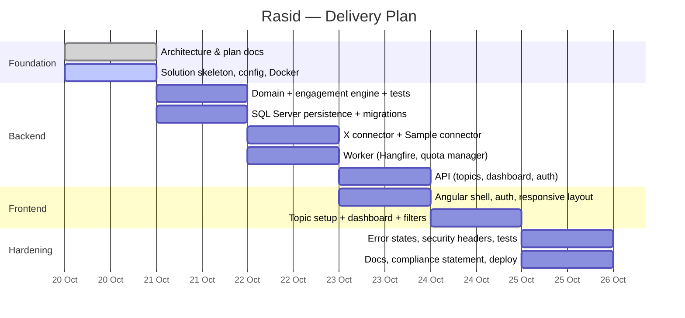

# 01 — Project Plan

## 1. Objective

Deliver a production-ready application that lets analysts:

1. Define **monitoring topics** using keywords, hashtags and public accounts.
2. Automatically collect **public posts** matching each topic through the **official X API v2**.
3. View **engagement indicators** — posts, likes, reposts, replies, quotes, views, engagement rate and engagement level — with a transparent formula.
4. **Filter** by date range, keyword and engagement type, and see a **visual summary**.
5. Always know **when data was last updated**, **where it came from**, and **what happened** when data is unavailable.

## 2. Scope

### In scope

| Area | Capability |
|------|-----------|
| Topic management | Create, edit, pause/resume, delete topics; live preview of the generated X query; validation against X query limits |
| Ingestion | Scheduled, quota-aware collection via X API v2 Recent Search; incremental fetch (`since_id`); tiered metric refresh |
| Analytics | KPI tiles, posts-over-time, engagement breakdown, top posts, engagement-level distribution |
| Filtering | Date range, keyword/rule, engagement type, engagement level |
| Data freshness | "Last updated" timestamp, data-source badge (Live X API / Sample), stale-data indicator |
| Resilience | Defined UI states for: no credentials, invalid credentials, rate-limited, connection failure, no results |
| Compliance | Official API only, retention & deletion sync, display requirements, audit log |
| Security | Authentication, role-based authorisation, secret management, hardened database access |
| Operations | Docker images, Docker Compose, health checks, structured logging, Dev/UAT/Production configuration |
| UX | Mobile-first responsive UI, keyboard accessible, WCAG 2.1 AA colour contrast |

### Out of scope (this release)

- Platforms other than X (the connector model supports adding them later).
- Real-time streaming (X Filtered Stream) — requires a higher X API tier; the architecture is ready for it.
- Sentiment analysis or any inference about individual users (deliberately excluded — see compliance).

## 3. Delivery phases

## 4. Deliverables

1. Source code repository (backend, frontend, tests, Docker files).
2. Running application (local via Docker Compose; then a hosted demo URL).
3. Architecture documentation (this folder).
4. Engagement calculation method ([06](06-engagement-metrics.md)).
5. X compliance statement ([07](07-x-api-and-compliance.md)).
6. Known limitations and assumptions (below).

## 5. Assumptions

| # | Assumption | Impact if wrong |
|---|-----------|-----------------|
| A1 | The client will procure an X API plan that includes Recent Search read access. | Without it the system runs in clearly labelled **Sample mode**; all other features work unchanged. |
| A2 | Recent Search covers the **last 7 days**; older history is built up by Rasid over time. | Historical back-fill requires X Full-Archive Search (higher tier). |
| A3 | View counts (`impression_count`) are returned for public posts by the API plan in use. | If absent, engagement rate shows **"N/A"** — never an estimate. |
| A4 | Microsoft SQL Server is the client's approved database standard. | EF Core keeps the provider swappable. |
| A5 | Users are internal analysts (tens to low hundreds). | Higher volumes are handled by scaling API/Worker replicas — see [02](02-architecture.md#7-scalability). |

## 6. Dependencies on the client

- X Developer account, project/app and Bearer token (stored only in the secret store).
- Hosting environment and identity provider decision for UAT/Production.
- Data retention period (default: 30 days for post content, 13 months for aggregated metrics).
- Confirmation of the end-user organisation type — X's Developer Policy has specific requirements for government-related use.

## 7. Known limitations

- Data freshness is bounded by the X API plan's rate limits and monthly read quota; the Quota Manager trades freshness for cost predictably.
- Recent Search is limited to 7 days at query time.
- Metrics are point-in-time snapshots; values between refreshes are not interpolated.
