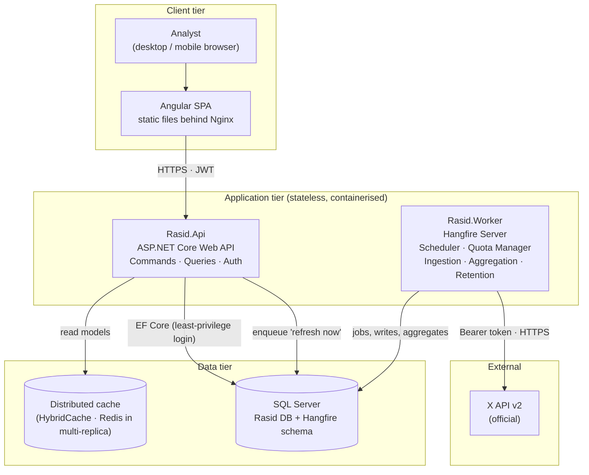
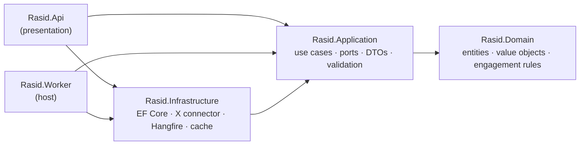
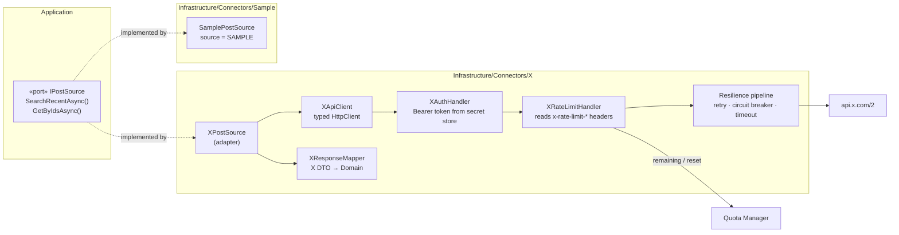
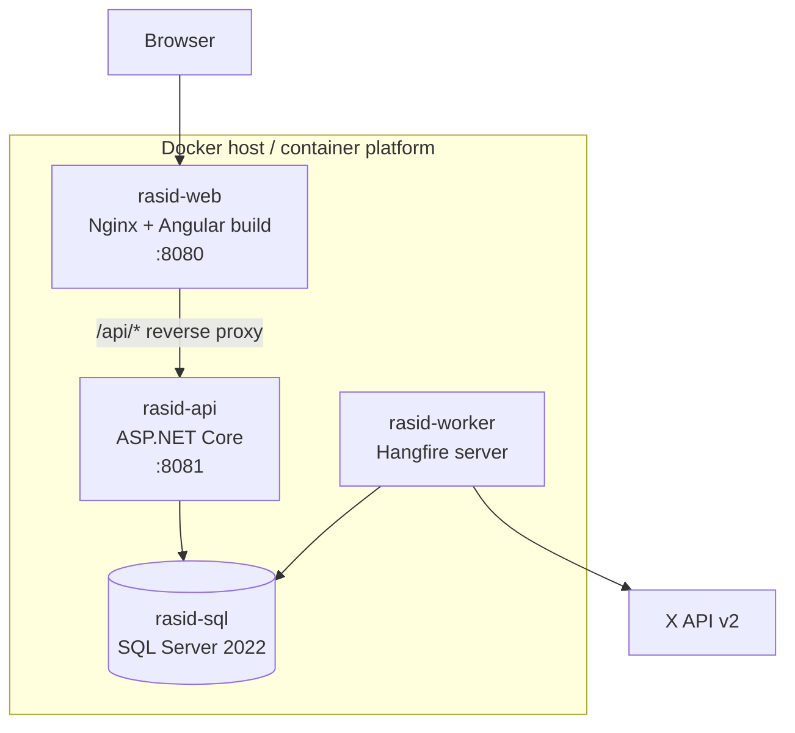

# 02 — Solution Architecture

## 1. Architectural drivers

The binding constraint of this system is **not compute — it is the X API's rate limits, monthly read quota and cost.**
Every structural decision follows from one question:

> *How do we deliver the freshest, most reliable data with the fewest API calls — without ever stepping outside X's rules?*

| Driver | Consequence in the design |
|--------|---------------------------|
| X API quota & cost | Users never call X. A single Worker owns all X traffic, governed by a Quota Manager. |
| Dashboard must stay fast as data grows | Reads are served from pre-aggregated tables (CQRS-lite) + cache. |
| X can be slow, rate-limited or down | Ingestion is asynchronous and isolated; the UI keeps serving last-known-good data marked as stale. |
| Compliance | Retention, deletion sync and display rules are built into the pipeline, not bolted on. |
| Security-sensitive client | SQL Server security features, least-privilege identities, no secrets in code or config files. |
| Long-term evolution | Clean Architecture + connector model: new platforms, new UI or new database without rewriting the core. |

## 2. Logical view



### The three rules that make it scale

1. **Read path and write path are separated (CQRS-lite).** The API answers dashboards from aggregates; only the Worker writes posts and metrics. 500 users opening dashboards cost **zero** X API calls.
2. **Ingestion is asynchronous and isolated.** X being slow or down never blocks the UI.
3. **X is a connector, not the core.** The core depends on `IPostSource`; X is one adapter. Adding another platform is an additive change.

## 3. Clean Architecture — layers & dependency rule



**Dependencies point inward only.** Domain has no dependencies; Application depends only on Domain;
Infrastructure implements Application's ports. Business rules (engagement formula, query rules, quota policy)
are therefore testable without a database, HTTP or X.

| Project | Responsibility | Must NOT contain |
|---------|----------------|------------------|
| `Rasid.Domain` | Entities (`Topic`, `TopicRule`, `Post`, `MetricSnapshot`), value objects (`EngagementRate`, `XQuery`), domain services (`EngagementCalculator`, `XQueryBuilder`), domain errors | EF, HTTP, JSON attributes |
| `Rasid.Application` | Command/query handlers, ports (`IPostSource`, `IRasidDbContext`, `IQuotaManager`, `IClock`, `ICurrentUser`), DTOs, FluentValidation validators, `Result<T>` | Concrete infrastructure |
| `Rasid.Infrastructure` | EF Core `DbContext` + configurations + migrations, **X connector**, Sample connector, Hangfire jobs, caching, options binding | Business rules |
| `Rasid.Api` | Endpoints, authentication/authorisation, ProblemDetails, rate limiting, security headers, OpenAPI | Data access logic |
| `Rasid.Worker` | Hangfire server host, recurring job registration | Endpoints |

## 4. Solution structure

```
Rasid/
├── docs/                         ← this documentation
├── src/
│   ├── backend/
│   │   ├── Rasid.Domain/
│   │   ├── Rasid.Application/
│   │   ├── Rasid.Infrastructure/
│   │   │   ├── Persistence/          DbContext, configurations, migrations
│   │   │   ├── Connectors/
│   │   │   │   ├── X/                XApiClient, handlers, mappers, options
│   │   │   │   └── Sample/           SamplePostSource (labelled)
│   │   │   ├── Jobs/                 ingestion, metrics refresh, aggregation, retention
│   │   │   └── Configuration/        endpoints.{Environment}.json loader
│   │   ├── Rasid.Api/
│   │   └── Rasid.Worker/
│   └── frontend/
│       └── rasid-web/            ← Angular app
├── tests/
│   ├── Rasid.Domain.Tests/
│   ├── Rasid.Application.Tests/
│   └── Rasid.Api.IntegrationTests/
├── deploy/
│   └── docker/                   Dockerfiles, docker-compose.yml, .env.example
├── Directory.Build.props         shared compiler settings (nullable, warnings-as-errors)
├── Directory.Packages.props      central package version management
└── global.json                   pinned .NET SDK
```

## 5. X integration — the core subsystem



- **Connector selection** is configuration-driven: if no X credentials are configured the Sample connector is used and every screen shows a **SAMPLE DATA** badge. There is no silent fallback in Production — misconfiguration fails health checks.
- **Base URLs** (`https://api.x.com/2`, etc.) live only in `endpoints.{Environment}.json` — see [09](09-environments-and-configuration.md).
- **Endpoints used:** `GET /2/tweets/search/recent` (discovery) and `GET /2/tweets` (batched metric refresh & deletion detection). Details in [07](07-x-api-and-compliance.md).

## 6. Deployment view (Docker)



- All containers run as **non-root**, with health checks.
- API and Worker are separate images from the same codebase → they scale independently.
- Locally, `docker compose up` starts the full stack; the same images are promoted Dev → UAT → Production with only configuration changing.

## 7. Scalability

The same codebase scales by changing infrastructure, not code:

| Dimension | Stage 1 — Initial | Stage 2 — Growth | Stage 3 — Enterprise |
|-----------|-------------------|------------------|----------------------|
| Topics | 1–50 | 50–500 | 1,000s, multi-department |
| Concurrent users | < 20 | 20–200 | 1,000+ |
| API replicas | 1 | 2–4 behind load balancer | Auto-scaled |
| Worker replicas | 1 | 2–3 (Hangfire distributed locks prevent duplicate jobs) | Per-connector worker pools |
| Cache | In-process (HybridCache L1) | HybridCache + Redis L2 | Redis cluster |
| Database | Single SQL Server | Larger tier, partitioned metric tables | Read replicas, columnstore for analytics |
| X ingestion | Scheduled polling + Quota Manager | Same, tuned per topic priority | Filtered Stream connector (real-time) |

**Why it scales without rewrite:** stateless API, read/write separation, independently scalable Worker, distributed job locking, and the connector abstraction.

## 8. Analytics read models

| Endpoint | Purpose | Source |
|----------|---------|--------|
| `GET /topics/{id}/dashboard` | KPIs, trends against the previous period, multi-series time line with spike flags, breakdown, levels, top posts | Hourly aggregates (or posts when keyword/level filters apply) |
| `GET /topics/{id}/insights` | Top hashtags, top accounts, activity heatmap, rule performance, languages, highlights | Topic- and period-bounded post slice (max 20,000) |
| `GET /overview` | All topics, last 7 days against the previous 7, with daily sparklines | Hourly aggregates |
| `GET /alerts` | Activity spikes, collection problems, stale data, budget pressure, derived on demand | Aggregates + topic state + quota |

All are cached briefly. The cache key includes the topic's last refresh time, so new data is never hidden.

## 9. Concurrency

Different topics can match the same post. Collection runs therefore serialise **only their database
writes** with a distributed lock (`rasid:post-writes`, held in SQL Server through Hangfire), while the
X API calls stay parallel. Per-topic locks prevent two runs of the same topic. A regression test runs
two topics sharing posts in parallel.

## 10. Cross-cutting concerns

| Concern | Approach |
|---------|----------|
| Error handling | `Result<T>` in application layer; RFC 9457 ProblemDetails at the API boundary; no stack traces to clients |
| Validation | FluentValidation on every command; Angular reactive-form validation mirrors server rules |
| Logging | Structured logs (Serilog) with correlation IDs; secrets and tokens are never logged |
| Observability | OpenTelemetry traces & metrics; health endpoints `/health/live`, `/health/ready` |
| Time | All timestamps stored in UTC; displayed in the user's local time zone |
| Localisation | UI built RTL-ready for Arabic |
