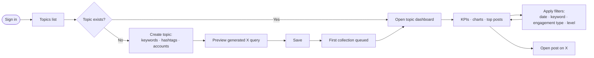
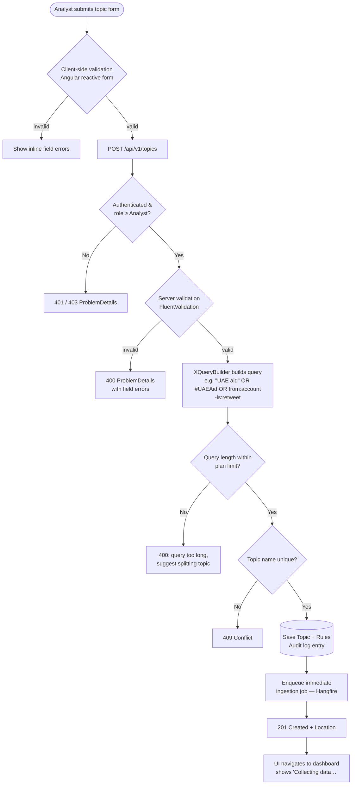
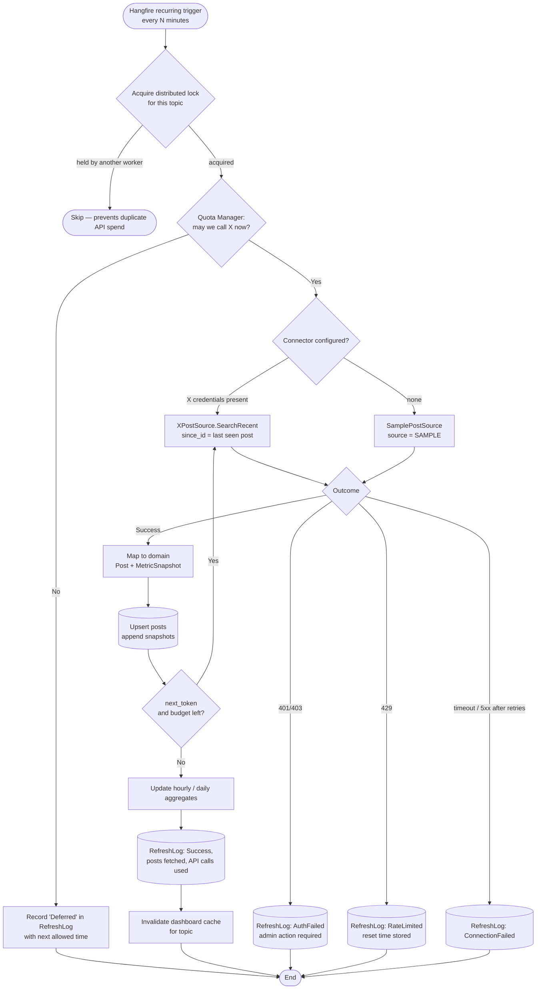
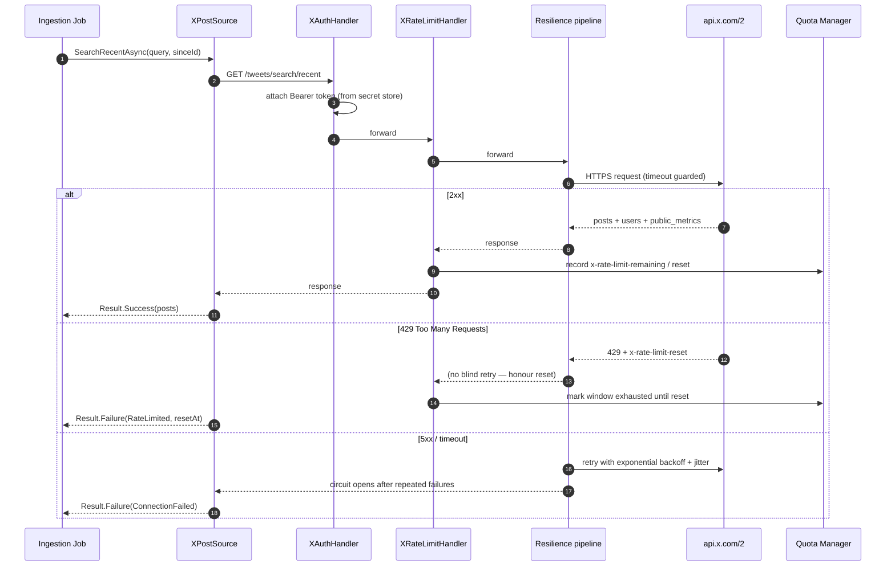
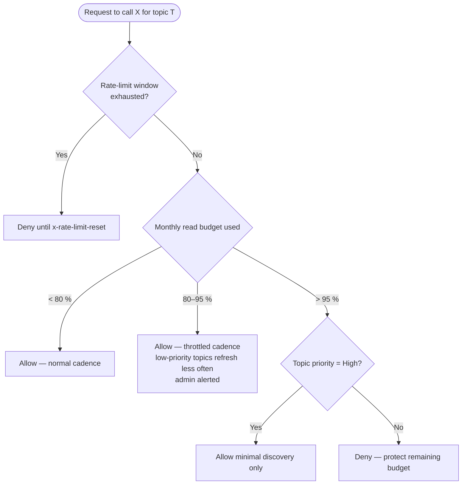
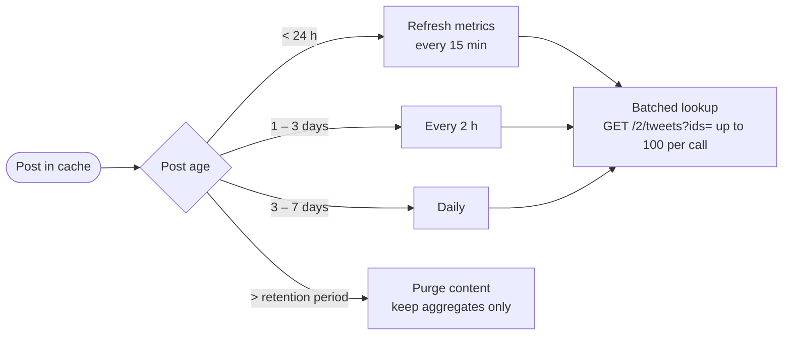
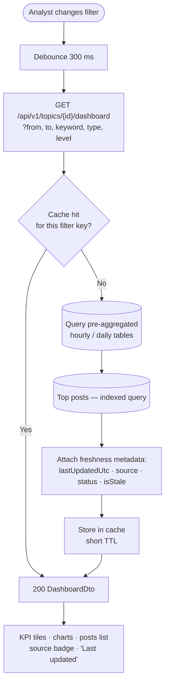
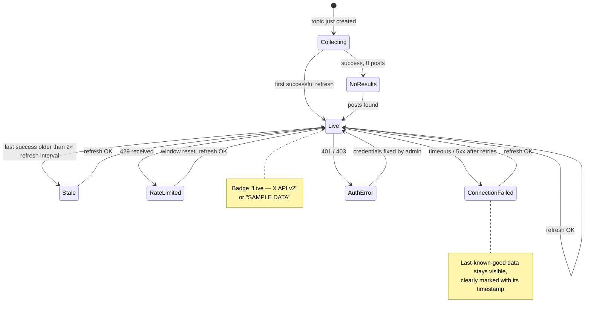
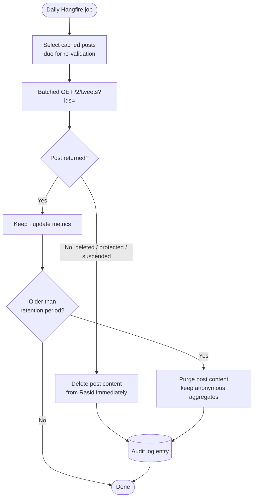
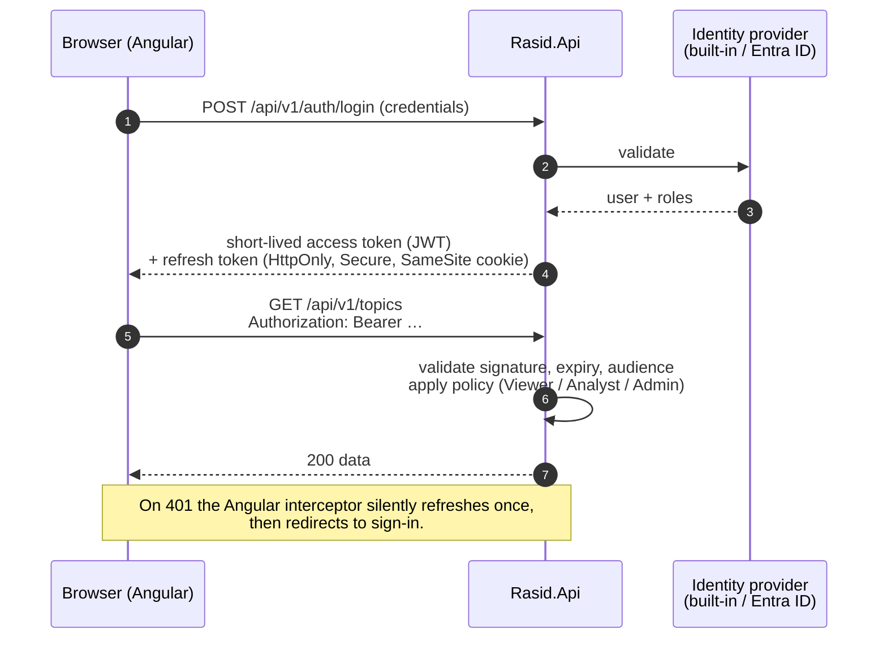

# 03 — Flowcharts

Every important runtime flow, end to end.

1. [User journey (end to end)](#1-user-journey-end-to-end)
2. [Create a monitoring topic](#2-create-a-monitoring-topic)
3. [Scheduled ingestion job](#3-scheduled-ingestion-job)
4. [Calling the X API (resilience & rate limits)](#4-calling-the-x-api-resilience--rate-limits)
5. [Quota Manager decision](#5-quota-manager-decision)
6. [Tiered metric refresh](#6-tiered-metric-refresh)
7. [Dashboard query with filters](#7-dashboard-query-with-filters)
8. [Data availability states shown to the user](#8-data-availability-states-shown-to-the-user)
9. [Retention & deletion compliance job](#9-retention--deletion-compliance-job)
10. [Authentication & authorisation](#10-authentication--authorisation)

---

## 1. User journey (end to end)

## 2. Create a monitoring topic

## 3. Scheduled ingestion job

## 4. Calling the X API (resilience & rate limits)

## 5. Quota Manager decision

## 6. Tiered metric refresh

Engagement on a post decays quickly, so refresh effort follows the post's age.

## 7. Dashboard query with filters

## 8. Data availability states shown to the user

## 9. Retention & deletion compliance job

## 10. Authentication & authorisation

| Role | Permissions |
|------|-------------|
| Viewer | View dashboards |
| Analyst | Viewer + create / edit / pause topics, trigger refresh |
| Admin | Analyst + manage users, view system status, Hangfire dashboard, quota settings |
