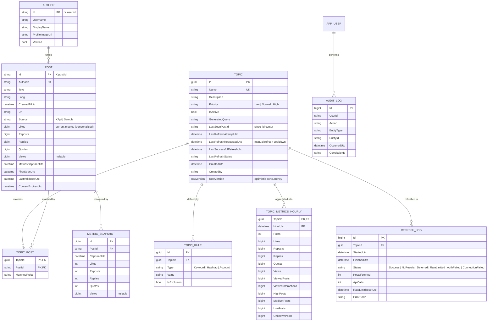

# 05 — Data Model

## Design notes

- **Many-to-many Topic ↔ Post.** One post may match several topics; it is stored once (no duplicate content, single deletion point).
- **Metric snapshots are append-only.** They keep the history; the post row holds the current values (denormalised) so lists and rankings need no join.
- **`TOPIC_METRICS_HOURLY`** is the read model for dashboards (CQRS-lite). Daily views are rolled up from it. `ViewedPosts` / `ViewedInteractions` cover only posts that have a view count, so the engagement rate is never inflated by posts without views (see [06](06-engagement-metrics.md)). Level counts (`HighPosts` …) power the level distribution without touching raw posts.
- **Schemas.** `rasid` (application), `auth` (identity), `hangfire` (jobs) — permissions can be granted per schema.
- **Minimal author data.** Only what X's display requirements need. No follower graphs, no profiling.
- **Retention.** `ContentExpiresUtc` drives purging of post text and author details; aggregates (which contain no personal content) are kept longer.
- **Concurrency.** `rowversion` on `TOPIC` prevents lost updates when two analysts edit the same topic.
- **Indexes.** `POST(CreatedAtUtc)`, `TOPIC_POST(TopicId, PostId)`, `METRIC_SNAPSHOT(PostId, CapturedUtc DESC)`, clustered key on `TOPIC_METRICS_HOURLY(TopicId, HourUtc)`. Columnstore on snapshots when volume justifies it.
