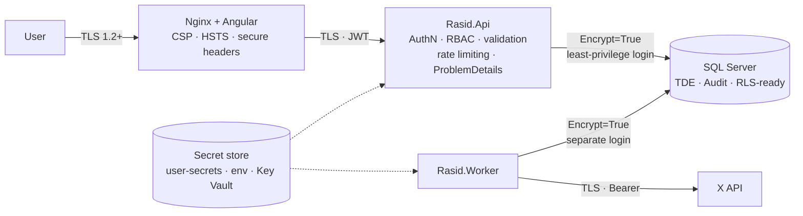

# 08 — Security

Security is applied in depth — each layer assumes the one in front of it may fail.

## 1. Identity & access

| Control | Implementation |
|---------|----------------|
| Authentication | JWT bearer tokens (short-lived access token, rotating refresh token in HttpOnly + Secure + SameSite cookie). Identity provider pluggable: built-in ASP.NET Core Identity or Microsoft Entra ID (OIDC) via configuration |
| Password policy | Min length 12, lockout after repeated failures, PBKDF2 hashing (ASP.NET Core Identity) |
| Authorisation | Policy-based RBAC: `Viewer`, `Analyst`, `Admin`; enforced server-side on every endpoint (UI hiding is cosmetic only) |
| Hangfire dashboard | Admin role only, not exposed on the public ingress |
| Session security | Tokens never stored in `localStorage`; access token kept in memory |

## 2. Application security (OWASP Top 10 mapping)

| Risk | Mitigation |
|------|-----------|
| A01 Broken access control | Policy checks on every endpoint; resource ownership checks; deny by default |
| A02 Cryptographic failures | TLS everywhere; TDE at rest; no custom crypto |
| A03 Injection | EF Core parameterised queries only; no raw SQL concatenation; X query built by a whitelist-based builder; Angular auto-escaping (no `innerHTML` with untrusted data) |
| A04 Insecure design | Threat-modelled flows (see [03](03-flowcharts.md)); quota and retention enforced in the domain |
| A05 Security misconfiguration | Hardened response headers (CSP, HSTS, X-Content-Type-Options, Referrer-Policy, frame-ancestors none); detailed errors disabled outside Development; strict CORS allow-list from endpoint config |
| A06 Vulnerable components | Central package management; `dotnet list package --vulnerable` and `npm audit` in CI; pinned base images |
| A07 Identification & auth failures | Lockout, rate-limited login endpoint, short token lifetime, refresh-token rotation and revocation |
| A08 Software & data integrity | Signed container images in CI; lock files committed |
| A09 Logging & monitoring failures | Structured security logs (login, role changes, topic changes) to the audit log; tokens/PII never logged |
| A10 SSRF | Outbound HTTP only to allow-listed base URLs from `endpoints.{Environment}.json` |

Additional: API rate limiting per user/IP, request size limits, anti-automation on login, `ProblemDetails` without stack traces.

## 3. Database security (SQL Server)

| Control | Detail |
|---------|--------|
| Least-privilege logins | `rasid_api` (read/write on app schema only), `rasid_worker` (write + Hangfire schema), `rasid_migrator` (DDL, used only by the deployment pipeline). No `sa` / `sysadmin` for the application |
| Encryption in transit | `Encrypt=True; TrustServerCertificate=False` outside local development |
| Encryption at rest | Transparent Data Encryption; encrypted backups |
| Auditing | SQL Server Audit / Azure SQL Auditing for logins and schema changes |
| Row-Level Security | Schema designed so RLS can isolate departments/tenants when required |
| Dynamic Data Masking | Available for any sensitive columns introduced later |
| Password-less (hosted) | Microsoft Entra authentication with Managed Identity |

## 4. Secrets management

| Environment | Store |
|-------------|-------|
| Development | `dotnet user-secrets` (outside the repository) |
| Docker (local) | `.env` file — **git-ignored**; `.env.example` documents the keys without values |
| UAT / Production | Environment variables injected by the platform, backed by a vault (e.g. Azure Key Vault) |

Secrets include: X Bearer token, database credentials, JWT signing key. **None are present in source code or `appsettings*.json` / `endpoints*.json`.**
Startup validation fails fast if a required secret is missing in UAT/Production.

## 5. Container security

- Multi-stage builds; runtime images contain no SDK or source.
- Containers run as a **non-root** user; read-only root filesystem where possible.
- Only the web container is exposed publicly; API, Worker and SQL Server are on an internal network.
- Health checks for orchestrator restarts.

## 6. Privacy

- Only public data, minimum fields, limited retention (see [07](07-x-api-and-compliance.md)).
- No profiling, no sensitive-attribute inference.
- Audit trail for all administrative actions.
