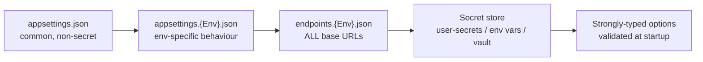
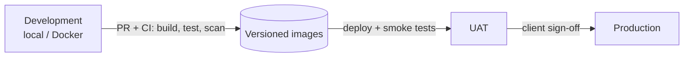

# 09 — Environments & Configuration

## 1. Environments

| Environment | Purpose | `ASPNETCORE_ENVIRONMENT` | Angular build configuration | Data source |
|-------------|---------|--------------------------|-----------------------------|-------------|
| **Development** | Engineer workstation / local Docker | `Development` | `development` | Sample by default; X if a token is set in user-secrets |
| **UAT** | Client acceptance testing | `UAT` | `uat` | X API (test project/app) or Sample, explicitly configured |
| **Production** | Live service | `Production` | `production` | X API only — Sample is disabled |

## 2. Configuration layering (backend)

Later sources override earlier ones:



| File | Contains | Never contains |
|------|----------|----------------|
| `appsettings.json` | Logging defaults, engagement thresholds, quota policy defaults, refresh intervals | URLs, secrets |
| `appsettings.{Env}.json` | Environment behaviour (log levels, sample-mode allowed, retention days) | URLs, secrets |
| **`endpoints.{Env}.json`** | **Every base URL** the system uses | Secrets |
| Secret store | X Bearer token, DB connection string, JWT signing key | — |

### Base-URL files — single source of truth

```
src/backend/config/
├── endpoints.Development.json
├── endpoints.UAT.json
└── endpoints.Production.json
```

```json
{
  "Endpoints": {
    "XApi":        { "BaseUrl": "https://api.x.com/2/" },
    "XWeb":        { "PostUrlTemplate": "https://x.com/{username}/status/{postId}" },
    "WebApp":      { "BaseUrl": "http://localhost:4200" },
    "Api":         { "BaseUrl": "http://localhost:5080" },
    "Cors":        { "AllowedOrigins": [ "http://localhost:4200" ] },
    "Identity":    { "Authority": "" }
  }
}
```

- Loaded once by `Rasid.Infrastructure.Configuration`, bound to a strongly-typed `EndpointsOptions` class.
- Validated at startup (`ValidateOnStart`): every URL must be absolute; UAT/Production URLs must be HTTPS.
  UAT also accepts loopback HTTP URLs (`http://localhost:8080`, the local Docker stack), which are not reachable
  from the network. Production and the X API base URL always require HTTPS.
- Code consumes `IOptions<EndpointsOptions>` — **no URL literals anywhere else in the codebase**.
- The outbound HTTP allow-list (SSRF protection) is derived from this file.

## 3. Frontend configuration

```
src/frontend/rasid-web/src/environments/
├── environment.ts              ← development
├── environment.uat.ts
└── environment.production.ts
src/frontend/rasid-web/src/app/core/config/
└── api-endpoints.ts            ← every API route path, in one place
```

- `environment.*.ts` holds the **API base URL** and environment flags only. Angular's `fileReplacements` swaps the file per build configuration (`ng build --configuration uat`).
- `api-endpoints.ts` holds relative route paths (`topics`, `topics/:id/dashboard`, …). Services compose `baseUrl + path`; no URL strings inside components or services.
- No secrets are ever shipped to the browser.

## 4. Docker configuration

```
deploy/docker/
├── docker-compose.yml          ← full local stack
├── .env.example                ← documented keys, no values (committed)
└── .env                        ← real values (git-ignored)
```

The same images run in every environment; only `ASPNETCORE_ENVIRONMENT`, the `endpoints.{Env}.json` file and injected secrets differ.

**Running the local stack as UAT.** In `.env` set `RASID_ENVIRONMENT=UAT` (backend: `appsettings.UAT.json`,
`endpoints.UAT.json`) and `RASID_WEB_CONFIGURATION=uat` (Angular `environment.uat.ts`), then
`docker compose up -d --build`. The compose file overrides the web/API/CORS URLs with `http://localhost:8080`, so the
UAT configuration runs locally; the stack keeps its own SQL Server container and `sql-data` volume
(`docker compose down -v` gives a clean database).

## 5. Promotion flow


